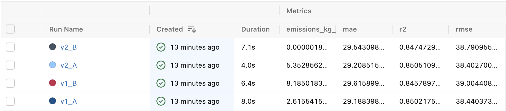
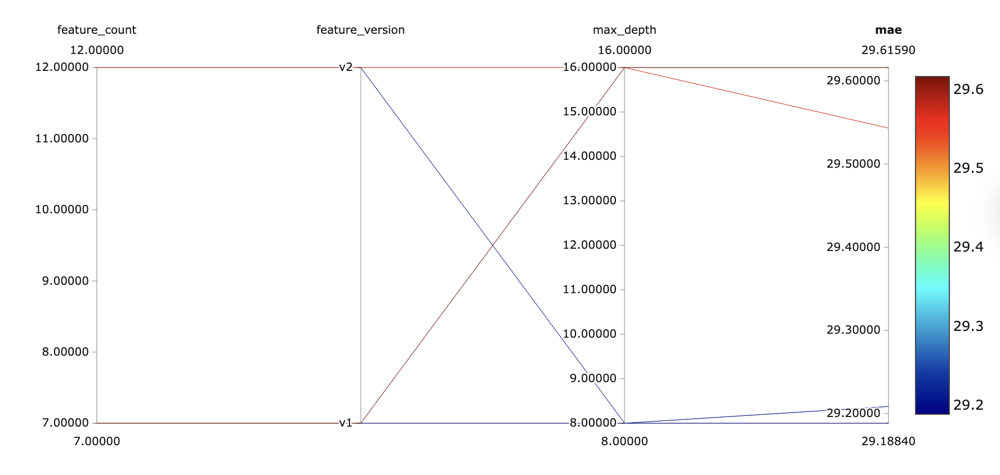
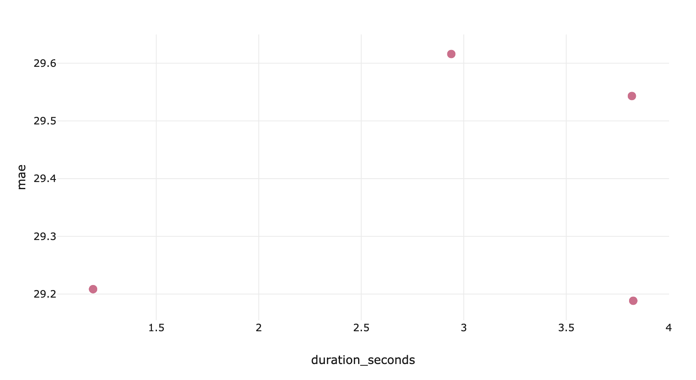
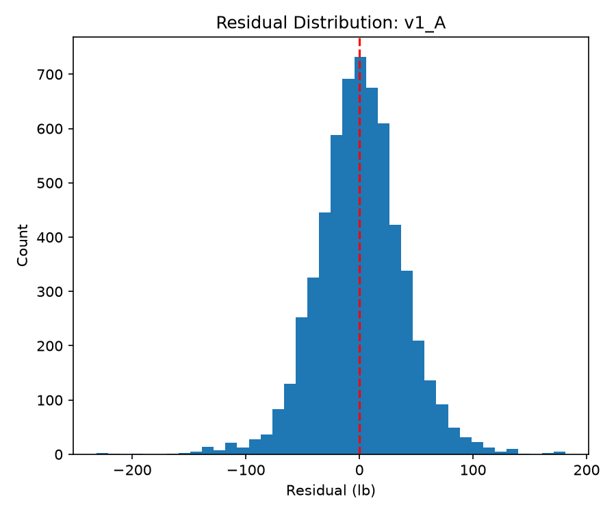
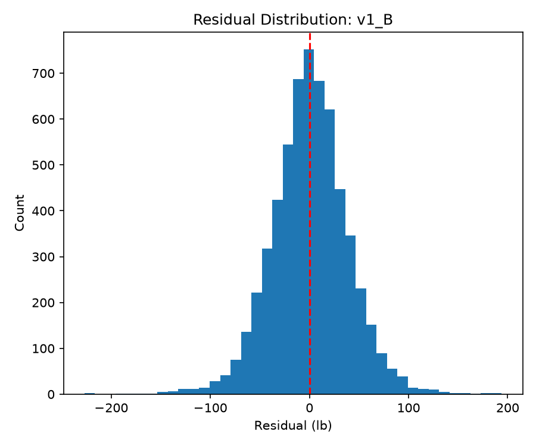
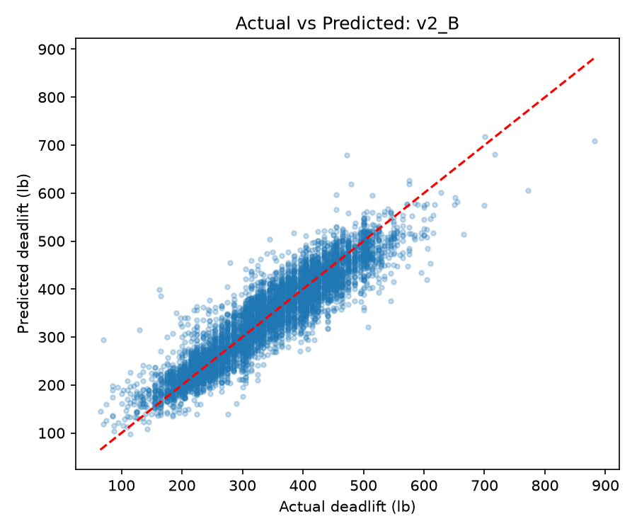
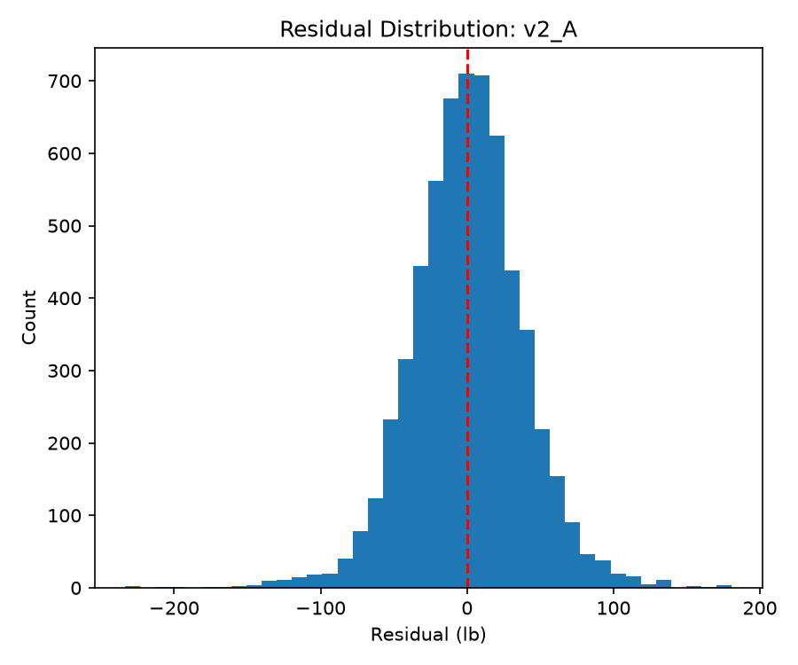
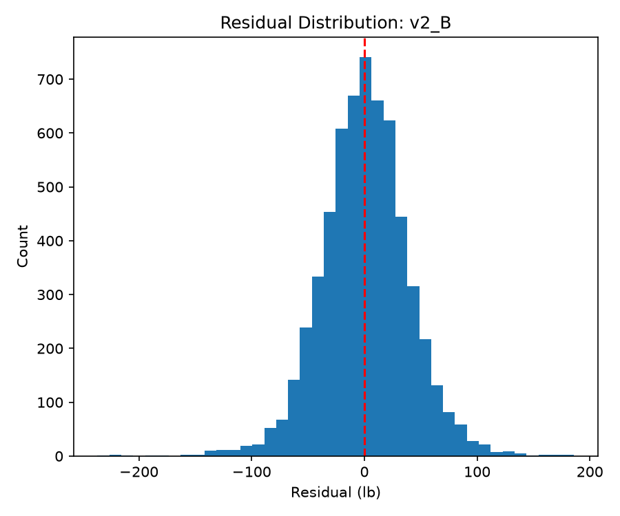
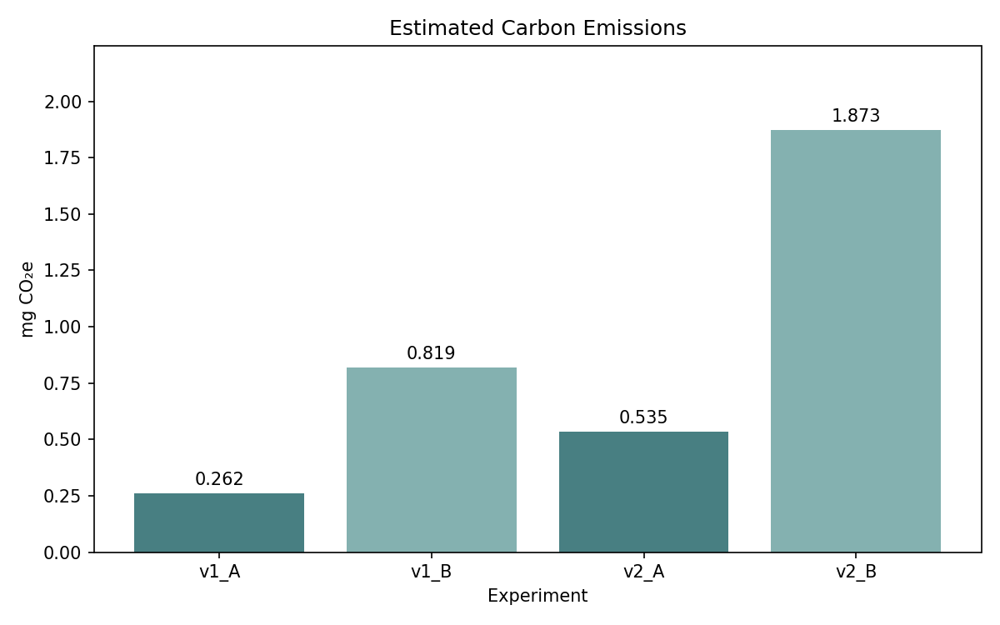

# Athlete Performance Prediction: Feature Store and ML Pipeline

## Project Overview

This project demonstrates an end-to-end machine learning pipeline integrating a Feast Feature Store, MLflow experiment tracking, and CodeCarbon emissions monitoring.

Using athlete performance data, the objective is to predict deadlift performance (in pounds) and evaluate how feature engineering and model hyperparameters affect predictive accuracy, computational efficiency, and estimated carbon emissions.

Four experiments were conducted using the same Random Forest regression algorithm, two feature versions, and two manually selected hyperparameter configurations. No AutoML was used.

## 1. Technology Stack

| Component | Technology |
|---|---|
| Data processing | Pandas, NumPy |
| Feature Store | Feast |
| ML pipeline | scikit-learn |
| Experiment tracking | MLflow |
| Emissions monitoring | CodeCarbon |
| Visualization | Matplotlib |
| Model | Random Forest Regressor |

## 2. Dataset and Preparation

The original `athletes.csv` dataset contains 423,006 records and 27 columns, including demographic information, training characteristics, and athletic performance measurements.

The prediction target is `deadlift`, measured in pounds.

Data preparation included:

- Removing records without valid athlete IDs or deadlift targets.
- Filtering implausible target values.
- Removing duplicate athlete IDs.
- Marking implausible predictor values as missing.
- Encoding gender as a numeric indicator.
- Generating engineered features for V2.
- Selecting a reproducible sample of 30,000 athletes.

Missing predictor values were handled through median imputation within the scikit-learn training pipeline, preventing test-set information from influencing imputation.

The dataset was divided into 80% training and 20% testing, using a fixed random seed of 42.

**Dataset availability:** The `athletes.csv` dataset was provided as part of a course assignment and is not redistributed in this repository. To reproduce the experiments, place an authorized copy of `athletes.csv` in the `data/` directory before running the pipeline.

## 3. Feature Store Design

Feast was used to register and retrieve two feature views, each associated with the same `athlete_id` entity.

**Version 1 — Baseline Features (7)**

Age, height, weight, gender indicator, back squat, clean and jerk, and snatch.

**Version 2 — Engineered Features (12)**

All seven baseline features plus:

- Body Mass Index (BMI)
- Back squat relative to body weight
- Clean and jerk relative to body weight
- Snatch relative to body weight
- Combined strength total

Feature data was stored in Parquet format and retrieved using Feast's historical feature retrieval API.

Because the source dataset does not include observation timestamps, illustrative timestamps were assigned for this static feature-store demonstration. These do not represent actual historical observations.

## 4. Experiment Design

Four experiments were conducted using Random Forest regression.

| Experiment | Feature version | Trees | Max depth | Min. leaf samples |
|---|---|---:|---:|---:|
| V1-A | Baseline | 50 | 8 | 5 |
| V1-B | Baseline | 100 | 16 | 2 |
| V2-A | Engineered | 50 | 8 | 5 |
| V2-B | Engineered | 100 | 16 | 2 |

The same train/test split was used for all four experiments to support direct comparison.

## 5. Quantitative Results

| Experiment | MAE (lb) | RMSE (lb) | R² | Duration (s) |
|---|---:|---:|---:|---:|
| V1-A | **29.19** | 38.44 | 0.8502 | 3.83 |
| V1-B | 29.62 | 39.00 | 0.8458 | 2.94 |
| V2-A | 29.21 | **38.40** | **0.8505** | 1.19 |
| V2-B | 29.54 | 38.79 | 0.8475 | 3.82 |

V1-A achieved the lowest mean absolute error, while V2-A achieved the lowest root mean squared error and highest R².

The differences between V1-A and V2-A were very small, suggesting that the additional engineered features did not meaningfully improve overall prediction accuracy in this experiment.

Configuration A outperformed Configuration B across all three predictive metrics for both feature versions.

### MLflow Experiment Tracking



The MLflow runs table documents the four successful experiments and their recorded evaluation metrics.

### Hyperparameter Comparison



The parallel coordinates visualization shows that Configuration A consistently achieved lower MAE than Configuration B, regardless of feature version.

### Execution Time vs. Prediction Error



The scatter plot compares measured execution duration with MAE. Longer execution times did not consistently correspond to better predictive performance.

## 6. Qualitative Model Evaluation

### Actual vs. Predicted Values


Both models demonstrate a strong relationship between actual and predicted deadlift performance, with observations generally clustered around the ideal prediction line.

However, both models tend to overpredict lower deadlift values and underpredict higher values, suggesting regression toward the mean.

V1-A appears slightly more concentrated around the reference line, consistent with its marginally better quantitative performance.

### Residual Distributions





Both residual distributions are approximately bell-shaped and centered near zero, suggesting limited overall directional bias.

V1-B appears slightly more symmetric, although the difference is not substantial. Both distributions exhibit long tails, indicating occasional large prediction errors.

Residual normality is not required for Random Forest regression.

### Engineered Feature Models








These plots provide the corresponding diagnostic comparisons for the engineered feature version. They should be examined for changes in prediction spread, systematic bias, and residual tails relative to V1.

## 7. Carbon Emissions Comparison

CodeCarbon was used to estimate emissions associated with each model's training and prediction process.

| Experiment | Estimated CO₂e (kg) | Estimated CO₂e (mg) |
|---|---:|---:|
| V1-A | 2.615542e-7 | 0.262 |
| V1-B | 8.185018e-7 | 0.819 |
| V2-A | 5.352856e-7 | 0.535 |
| V2-B | 1.873217e-6 | 1.873 |



V1-A produced the lowest estimated emissions, while V2-B produced the highest.

However, because each experiment completed in only a few seconds, these emissions estimates are sensitive to hardware utilization, sampling intervals, background processes, and measurement overhead. They should not be interpreted as precise or generalizable environmental differences between configurations.

## 8. Conclusions

The experiments demonstrate that greater model complexity and additional engineered features do not necessarily improve predictive performance.

Configuration A achieved better predictive accuracy than Configuration B for both feature versions. V1-A had the lowest MAE and estimated emissions, while V2-A achieved marginally better RMSE and R².

Given the minimal predictive improvements from feature engineering, V1-A represents a reasonable efficiency-focused configuration for this dataset.

The project also demonstrates the integration of feature versioning, reproducible training, experiment tracking, model evaluation, and environmental impact monitoring within a local MLOps workflow.

## 9. Limitations

- Athlete performance measurements are self-reported and may contain inaccuracies.
- Missing values and plausibility filtering may introduce selection bias.
- Results are based on a single random train/test split.
- The dataset has no genuine event timestamps.
- The engineered features are derived from existing measurements rather than new data sources.
- Short training durations limit the reliability of emissions comparisons.

## 10. Reproducing the Experiments

The project was developed using Python 3.11.

Create and activate a virtual environment:

```bash
python3.11 -m venv .venv
source .venv/bin/activate
pip install -r requirements.txt
```

Place `athletes.csv` in the `data/` directory.

Prepare and inspect the dataset:

```bash
python src/prepare_data.py
```

Register the Feast feature views:

```bash
python src/register_features.py
```

Verify historical feature retrieval:

```bash
python src/test_feature_store.py
```

Run all four experiments:

```bash
python src/train.py
```

Generate comparison visualizations:

```bash
python src/compare.py
```

Launch MLflow:

```bash
mlflow ui --backend-store-uri sqlite:///mlflow.db
```

Open `http://127.0.0.1:5000` to view the tracked experiments.

## 11. Repository Structure

```text
athlete-feature-store/
├── data/
│   └── athletes.csv
├── feature_repo/
│   ├── feature_store.yaml
│   └── features.py
├── src/
│   ├── prepare_data.py
│   ├── register_features.py
│   ├── test_feature_store.py
│   ├── train.py
│   └── compare.py
├── outputs/
│   ├── screenshots/
│   ├── comparison.csv
│   └── generated plots
├── requirements.txt
├── .gitignore
└── README.md
```